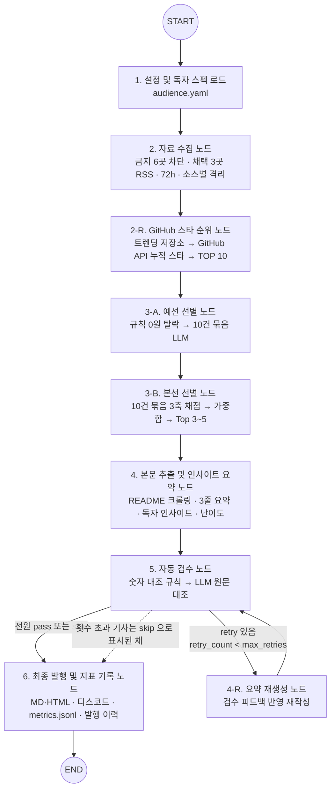
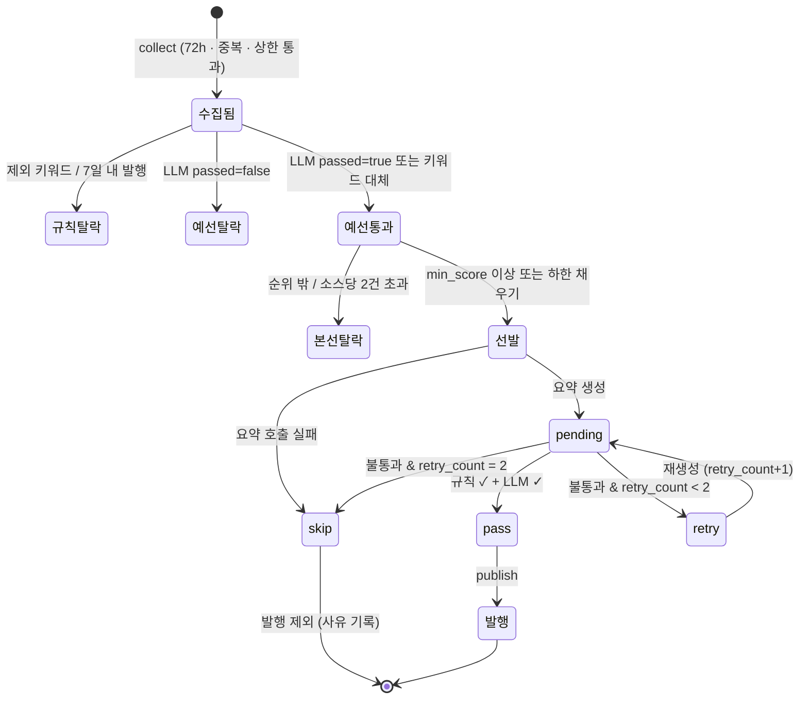
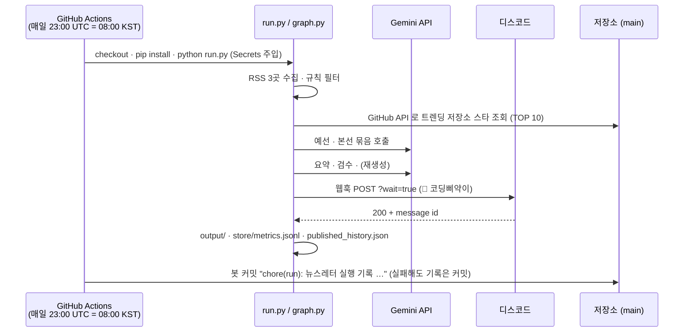

# 설계서 (DESIGN) — 🐣 바이브삐약 오픈소스 모닝 브리핑

> 기준: 제미나이 Argon 에서 만든 「전체 LangGraph 파이프라인 구조」 Mermaid 도식.
> 이 문서는 그 도식의 **노드 하나하나를 무엇을 받아 무엇을 내고, 왜 그렇게 정했고, 실패하면 어디로 가는지**로 풀어 쓴다.
> 스택 · 설정 키 · 기록 형식은 `TECH_SPEC.md`, 숫자 근거는 `REPORT.md`.

## 1. 기준 도식과 구현의 대응

| 기준 도식 노드 | 구현 함수 (`graph.py`) | 과제 필수 단계 |
|---|---|---|
| 1 설정 로드 | `load_config_node` | (준비) |
| 2 자료 수집 | `collect_rss_node` | ① 자료 수집 |
| 2-R 스타 순위 *(기준 도식에 없음 · 사용자 요청으로 추가)* | `rank_github_stars_node` | ① 수집 부가 · ⑤ 발행물의 한 섹션 |
| 3-A 예선 | `filter_prelim_node` (+ `run_prelim_batches`) | ② 자료 선별 |
| 3-B 본선 | `filter_final_node` | ② 자료 선별 |
| 4 본문 추출 · 요약 | `fetch_and_summarize_node` | ③ 요약 및 인사이트 |
| 5 자동 검수 | `evaluate_summary_node` + `route_after_eval` | ④ 검수 및 예외 처리 |
| 4-R 재생성 | `regenerate_summary_node` | ④ 검수 및 예외 처리 |
| 6 발행 · 지표 | `publish_newsletter_node` | ⑤ 최종 발행 |

도식의 "Fail 횟수 초과 시 해당 기사 스킵 → publish" 화살표는 **별도 엣지가 아니라 상태값**으로 구현했다. 검수 노드가 그 기사를 `skip` 으로 바꿔 두면 `route_after_eval` 이 볼 `retry` 가 사라져 자연히 publish 로 간다. 엣지를 하나 더 두면 "일부는 retry, 일부는 skip" 인 날 어느 쪽으로 갈지 모호해지기 때문이다.

## 2. 설계 원칙

1. **기준은 코드 밖에** — 독자 · 키워드 · 가중치 · 검수 기준 · 금지 소스는 모두 `audience.yaml`. 다른 독자용 뉴스레터는 yaml 만 바꿔 `AUDIENCE_CONFIG` 로 돌린다.
2. **싼 것부터 거른다** — 규칙(0원) → 묶음 LLM(저렴) → 기사별 LLM(비쌈). 비싼 호출은 3~5건에만.
3. **실패는 기사 · 소스 단위로 가둔다** — 노드 밖으로 예외를 내보내는 경우는 "설정이 규칙 위반"일 때뿐.
4. **모든 판정에 사유를 남긴다** — 통과 · 탈락 · 점수 · 검수 결과가 전부 `metrics.jsonl` 한 줄에.
5. **사실 칸과 해석 칸을 나눈다** — 요약(사실)은 원문 대조, 인사이트(해석)는 "원문에 없는 기능 · 숫자를 새로 만들지 않았는가"만.

## 3. 노드별 설계

### 3.1 `load_config` — 설정 및 독자 스펙 로드
- **입력** 없음 → **출력** `audience_config`, 빈 리스트들, `metrics` 골격, `run_id`(KST).
- `LLM_STATS` 를 0으로 되돌린다 (같은 프로세스에서 여러 번 돌려도 호출 수가 섞이지 않게).

### 3.2 `collect_rss` — 자료 수집
- **입력** `audience_config.sources` → **출력** `raw_articles`, `metrics.source_counts / source_errors`.
- **게이트(시작 전)**: 채택 소스의 `url` · `backup_url` 이 금지 URL(끝 `/` 정규화) 또는 금지 도메인(접미사 매칭)이면 `ValueError`. 채택 소스가 3곳 미만이어도 거부. *설정 실수는 조용히 넘기면 규칙 위반 뉴스레터가 나가므로 멈추는 게 맞다.*
- **소스마다**: `url` → 실패(HTTP 오류 · 0건) 시 `backup_url` → 그래도 실패면 0건으로 기록하고 다음 소스.
- **항목마다**: URL 중복 제거, 72시간 넘은 글 제외(시각 없는 글은 통과 — GitHub Trending RSS 는 시각이 없다), 소스당 25건 상한.
- RSS 본문은 두 벌로 보관한다 — 선별용 `raw_summary`(800자)와 요약용 `rss_text`(전체). GitHub Trending 은 RSS 에 README 전체(중앙값 1.2만 자)가 들어 있어 이게 크롤링 실패 시 그대로 본문이 된다.

### 3.2-R `rank_github_stars` — 🏆 오늘의 GitHub 트렌딩 스타 순위
- **입력** `trending_repos`(수집 노드가 GitHub Trending 피드 전체에서 뽑은 `owner/repo` 목록) → **출력** `github_ranking`(1~10위).
- **왜 따로 두나**: 큐레이션은 "입문자에게 쓸모 있는 3~5개"를 고르는 판단이고, 순위표는 "오늘 뜬 저장소의 규모"라는 사실이다. 판단과 사실을 섞으면 순위표까지 LLM 판정에 흔들리므로, 순위표는 **선별·요약·검수를 거치지 않고 API 숫자만** 쓴다.
- **기준**: GitHub REST API `/repos/{owner}/{repo}` 의 `stargazers_count`(누적 스타). RSS 에는 스타 수가 없다(확인함). "오늘 받은 스타"는 공식 API 가 주지 않아 쓰지 않는다.
- **후보가 10개 미만인 날**: `extra_feeds`(Python · TypeScript 일간 트렌딩)로 채우고, 그 저장소가 어느 피드에서 왔는지 `trending_feed` 로 남긴다.
- **제외 키워드**: 큐레이션과 같은 `exclude_keywords` 를 적용한다 (채용·코인 저장소 방지).
- **실패**: 저장소 하나의 API 실패는 그것만 빼고, 전부 실패하면 순위 섹션 없이 발행한다. Actions 에서는 `GITHUB_TOKEN` 으로 시간당 60회 → 1000회 한도.
- **배치**: 디스코드는 큐레이션 embed 뒤 마지막 embed(설명 4096자 안), MD 는 표, HTML 은 표 카드. 디스코드 6000자 예산에서 순위 embed 크기를 먼저 뺀다.

### 3.3 `filter_prelim` — 예선 (2단계 중 1단계)
- **입력** `raw_articles` → **출력** `prelim_articles`.
- **규칙 탈락(0원)**: 제외 키워드(영문은 단어 경계), 최근 7일 발행 이력. 사유 문자열에 걸린 키워드나 발행일을 그대로 넣는다.
- **LLM 묶음 판정**: 10건씩 `{id, title, source, url, snippet 250자}` → `{id, passed, reason}[]`. 시스템 프롬프트에 페르소나와 `importance_question` 을 넣는다.
- **누락 대처**: 응답에 없는 id(또는 묶음 호출 자체 실패)는 `include_keywords` 로 대체 판정하고 `decided_by=keyword_fallback` 으로 표시한다. *LLM 이 한 묶음을 놓쳤다고 그 묶음 10건을 통째로 버리면 하루치 후보의 1/4이 사라진다.*
- **batch_size=10 의 근거**: `tools/batch_experiment.py` 로 5 / 10 / 30 을 같은 후보에 돌려 비교 (REPORT 3절).

### 3.4 `filter_final` — 본선 (2단계 중 2단계)
- **입력** `prelim_articles` → **출력** `selected_articles`(3~5건).
- **채점**: 10건 묶음으로 3축(입문자 접근성 · 바이브코딩 활용성 · 화제성)을 0~1로 받고, 코드가 가중합(40/40/20)한다. *가중합을 LLM 에게 맡기지 않는 이유 — 계산은 결정적이어야 하고, 축별 점수가 로그에 남아야 "왜 이 순위인가"를 설명할 수 있다.* 범위 밖 값은 0~1로 자른다.
- **누락**: 응답에 없는 기사만 모아 한 번 더 → 그래도 없으면 0점 + 사유.
- **선발 규칙**:
  1. 점수순으로 `min_score(0.70)` 이상, 한 소스 최대 2건, `top_k(4)` 까지.
  2. 1에서 `min_k(3)` 건이 안 되면 차점자로 채우고 `selected_reason="하한 3건 채우기 (min_score 미달)"`.
- 모든 후보의 순위 · 점수 · 축별 점수 · 근거 · 선발 여부 · 선발 사유가 `selection_logs(stage=final_scoring)` 에 남는다.

### 3.5 `fetch_and_summarize` — 본문 추출 및 인사이트
- **입력** `selected_articles` → 같은 리스트에 `full_text, body_source, summary, beginner_insight, difficulty_stars`.
- **본문**: GitHub 은 `article.markdown-body`(README) → 그 외 `article/main/body`. 300자 미만이면 RSS 본문으로 대체(`rss_fallback`). 봇에 403을 주는 도메인(`news.hada.io`)은 **요청하지 않고** RSS 본문(`rss_only`)을 쓴다 — 차단을 우회하지 않는다.
- **요약 프롬프트**: 원문에 있는 사실만, 숫자는 원문 그대로, 원문이 짧으면 3줄을 억지로 채우지 말 것.
- **독자 표시**: `rss_only/rss_fallback` 기사는 발행물에 "📎 원문 미리보기 기반 요약" 표시를 붙인다. 독자가 요약의 한계를 알고 링크를 누르게.
- 요약 호출이 실패한 기사는 `skip` — 나머지 기사는 계속.

### 3.6 `evaluate_summary` — 자동 검수
- **입력** `pending` 기사 → `pass / retry / skip`.
- **1차 규칙(0원)**: 요약 + 인사이트에 나온 두 자리 이상 숫자가 원문(제목 · URL 포함)에 없으면 불통과. 쉼표는 정규화(`3,400` = `3400`). 한 자리 숫자는 목록 번호 오탐이 많아 뺐다.
- **2차 LLM**: yaml `checks` 3문장을 그대로 기준으로, 원문 · 요약 · 인사이트 · **난이도 표기** · 본문 출처를 함께 준다. *첫 실행에서 난이도를 안 넘겨 "난이도 표기 누락"으로 정상 요약이 반려됐다 — 그래서 넣었다.* 검수만 `thinking_level=medium`.
- 검수 호출이 실패하면 **불통과로 간주**(안전 쪽).
- 불통과 → `retry_count < max_retries(2)` 면 `retry`, 아니면 `skip` + "최대 재시도 초과" 사유.

### 3.7 `regenerate_summary` — 재생성
- `retry` 기사만, 검수 피드백 + 이전 요약 · 인사이트 + 원문으로 다시 쓴다.
- 호출이 실패해도 `retry_count` 는 이미 올렸으므로 루프는 최대 `1 + max_retries` 번 검수 후 반드시 끝난다. 그래프 차원에서도 `recursion_limit=30`.

### 3.8 `publish_newsletter` — 발행 및 기록
- `pass` 만 모아 `output/newsletter_YYYY-MM-DD.{md,html}`(HTML 은 전부 escape).
- 디스코드: 봇 이름 `🐣 코딩삐약이`, 본문 + embed(기사당 1개: 선별 지표 · 3줄 요약 · 실전 팁). 한도는 TECH_SPEC 8절. 0건이면 쉬어 가는 안내 1건.
- **실제로 보낸 경우에만** `published_history.json` 에 URL 기록 → dry-run 이 다음 날 발행을 막지 않게. 30일 지난 이력은 정리.
- `metrics.jsonl` 에 한 줄 append.

## 4. 상태 흐름 — 한 기사의 일생

## 5. 운영 흐름 (GitHub 연동)

## 6. 일부러 넣지 않은 것

| 안 넣은 것 | 이유 |
|---|---|
| 기사별 병렬 처리(`Send` 팬아웃) | 선발이 4건뿐이고 무료 한도(분당 9회)가 병목이라 병렬로 해도 빨라지지 않는다 |
| 체크포인터(중단 후 재개) | 하루 1회 · 4분짜리 배치라 처음부터 다시 도는 게 단순하다 |
| 브라우저 UA 위장 크롤링 | 사이트의 봇 차단을 우회하는 것이라 하지 않는다. RSS 로 충분한 범위만 쓴다 |
| Slack | 사용자 결정 — 디스코드만 |
