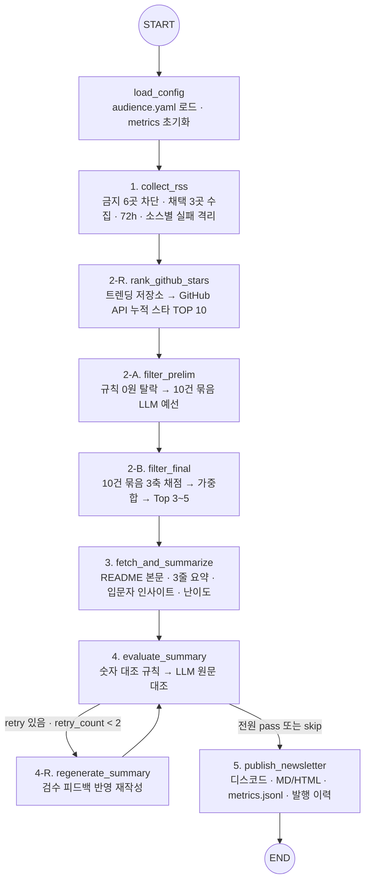
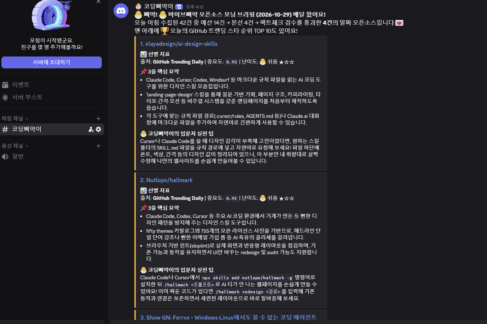

# [실습 프로젝트] 나만의 뉴스레터 에이전트 — 🐣 바이브삐약 오픈소스 모닝 브리핑

> 모두의연구소 AI에이전트 2기 · 2026-10-29 · 저장소 `ldk1575/vibe-ppiyak-newsletter`
> 이 보고서의 숫자는 모두 **이 저장소의 실행 기록에서 가져왔다** — `store/metrics.jsonl`(실행 로그), `store/source_measurement.json`(소스 실측), `store/batch_experiment.json`(묶음 크기 실험), `store/robustness_checks.json`(망가뜨려 본 시험).
> 설계 문서: [PRD.md](PRD.md) · [TECH_SPEC.md](TECH_SPEC.md) · [DESIGN.md](DESIGN.md) · 진행 기록: [작업기록.md](작업기록.md)

---

## 1. 분야 및 독자 정의

- **분야** — GitHub 트렌드 인기 오픈소스와 AI 에이전트 · 바이브코딩 도구 큐레이션.
- **왜 이 분야인가** — Claude Code · Cursor · Codex · MCP 생태계에서 매일 새 오픈소스가 쏟아지지만, 일반 AI 뉴스는 빅테크 모델 발표 위주라 "오늘 내 컴퓨터에 깔아 볼 도구"를 골라 주지 않는다.
- **독자(`audience.yaml` → `audience.persona`)** — AI 에이전트 구축과 바이브코딩에 막 입문한 병아리 개발자 · 학원 수강생 · 1인 빌더.
  - 고충 1: 쏟아지는 저장소 중 입문자가 바로 설치해 볼 만한 것을 구분하기 어렵다.
  - 고충 2: 영문 README 의 기능 나열만 봐서는 내 실습에 어떻게 붙일지 감이 오지 않는다.
- **제공 가치** — 기사마다 ① 무엇이고 무슨 문제를 푸는지 3줄 요약, ② 입문 난이도(🐣 쉬움 / 🐥 보통 / 🐓 도전), ③ 오늘 해 볼 실전 팁. 여기에 ④ **오늘의 GitHub 트렌딩 누적 스타 TOP 10** 표를 붙인다.
- **발행 채널** — 디스코드 채널 `#코딩삐약이`(봇 이름 `🐣 코딩삐약이`), 매일 08:00 KST GitHub Actions 자동 실행.

## 2. 소스 채택표

과제 규칙에 따라 금지 6곳(OpenAI · DeepMind · TechCrunch · The Verge · MIT TR · AI타임스)은 `audience.yaml` 의 `excluded_urls` + `excluded_domains` 로 **수집 시작 전에 검사해 실행을 거부**한다(시험 C1, 5절).

후보는 `tools/measure_sources.py` 로 실제로 쟀다 (측정 2026-10-29 16:12 KST, `store/source_measurement.json`).

| 후보 | 피드 | 건수 | 오픈소스 URL 포함률 | 관련률 | 48h / 72h 신선도 | 요약 길이 중앙값 | 판단 | 수치 근거 |
|---|---|---:|---:|---:|---:|---:|---|---|
| **GitHub Trending (일간)** | `mshibanami.github.io/GitHubTrendingRSS/daily/all.xml` | 14 | 100% | 85.7% | 시각 없음 | 12,211자 | **채택** | 모든 항목이 저장소 직링크, RSS 안에 README 전문이 들어 있어 본문 확보가 확실 |
| **GeekNews 공식 RSS** | `news.hada.io/rss/news` | 50 | 0% | 30.0% | 100% / 100% | 160자 | **채택** | 신선도 100%, 한국어 Show GN 이 독자와 가장 가깝다. feedburner 판(같은 50건)보다 응답 0.19초 vs 1.28초라 공식을 주, feedburner 를 백업으로 |
| **Show HN (points ≥ 20)** | `hnrss.org/show?points=20` | 20 | 40% | 30.0% | 20% / 30% | 231자 | **채택** | 개발자가 직접 공개한 도구라 오픈소스 URL 포함률 40%(후보 중 GitHub 다음). 신선도가 낮아 72시간 필터를 붙였다 |
| DEV Community #ai | `dev.to/feed/tag/ai` | 12 | 25% | 83.3% | 100% / 100% | 7,033자 | 예비 | 관련률은 높지만 튜토리얼 · 의견 글 위주라 "설치할 도구" 비율(오픈소스 URL 25%)이 Show HN 보다 낮다 |
| Hacker News Newest | `hnrss.org/newest` | 20 | 15% | 15.0% | 100% / 100% | 168자 | 탈락 | 노이즈율 85% — 예선 LLM 비용 대비 수율이 가장 낮다 |
| Hugging Face Blog | `huggingface.co/blog/feed.xml` | 891 | 0% | 12.9% | 0.3% / 0.3% | 0자 | 탈락 | 891건 중 72시간 이내 글이 0.3%, 요약 필드가 비어 있다 |
| HN 공식 showrss | `news.ycombinator.com/showrss` | 0 | — | — | — | — | 탈락 | 봇 요청에 419 응답 (같은 시각 curl 은 200) — 자동 수집이 불안정 |

- **관련률** = 제목 · 요약에 주제 키워드(`audience.yaml` 의 `include_keywords` 중 agent · mcp · claude · cli · 에이전트 …)가 하나라도 걸린 비율. `github.com` · `open-source` 처럼 저장소 자체를 뜻하는 키워드는 뺐다 — 넣으면 GitHub 소스가 무조건 100%가 된다.
- **측정에서 발견해 설계를 바꾼 것 둘**
  1. Show HN(points≥20)은 점수가 쌓인 오래된 글이 많아 48시간 이내 비율이 20%뿐 → 수집 노드에 `max_age_hours: 72` 를 넣었다. 실제 실행에서 20건 중 14건이 이 필터로 빠지고 6건이 남았다.
  2. GeekNews 토픽 페이지는 봇 요청에 **403** 을 준다. 브라우저로 위장하는 우회는 하지 않고, `summarize.no_fetch_domains` 로 요청 자체를 하지 않으며 RSS 미리보기(160~200자)만으로 요약한다. 그런 기사에는 발행물에 **"📎 원문 미리보기 기반 요약"** 표시를 붙인다.
- 첫 측정(15:38 KST) 때 hnrss 가 일시적으로 502 를 냈다. 측정 스크립트는 5xx 면 3초 뒤 1회 재요청하고, 수집 노드는 소스 하나가 죽어도 나머지로 계속한다(시험 C2).

## 3. 선별 로직 설계

### 중요도 판단 핵심 문장 (`selection_criteria.importance_question`)

> 이 오픈소스 또는 개발 도구는 AI 에이전트 · 바이브코딩 입문자가 복잡한 인프라 구축 없이 오늘 설치해 자신의 코딩 자동화나 에이전트 워크플로우 실습에 바로 적용할 수 있는가?

예선 · 본선 프롬프트가 모두 이 문장을 그대로 받는다. 독자를 바꾸려면 이 문장과 가중치만 바꾸면 된다.

### 예선 / 본선 2단계 구조

| 단계 | 하는 일 | 비용 | 남기는 근거 |
|---|---|---|---|
| 예선-규칙 | 제외 키워드(영문은 단어 경계) · 최근 7일 발행 이력 | 0원 | `stage=prelim_rule`, 걸린 키워드나 발행일 |
| 예선-LLM | 10건 묶음으로 관련성 판정 | 묶음당 1회 | `stage=prelim_batch`, `passed`, `reason`, `decided_by`(llm / keyword_fallback) |
| 본선 | 10건 묶음으로 3축 점수 → **코드가** 가중합 | 묶음당 1회 | `stage=final_scoring`, 순위 · 3축 점수 · 근거 · 선발 여부 · 선발 사유 |

$$\text{Score} = 0.40 \times \text{입문자 접근성} + 0.40 \times \text{바이브코딩·에이전트 활용성} + 0.20 \times \text{트렌드 화제성}$$

선발 규칙: 점수순으로 `min_score 0.70` 이상, **한 소스 최대 2건**, `top_k 4` 까지. 기준 통과가 3건 미만이면 차점자로 3건까지 채우고 `selected_reason` 에 "하한 3건 채우기"로 남긴다.

### 기준대로 동작했다는 증거 — 실제 발행 실행 `run_id 20261029_161001`

| 단계 | 결과 |
|---|---|
| 수집 | GitHub 11 · GeekNews 25(상한) · Show HN 6(72h 초과 14건 제외) = **42건** |
| 예선-규칙 | **3건** 탈락 — `jailbreaks`(탈옥 프롬프트 저장소), `소송`, `정치` 키워드 |
| 예선-LLM | 39건 전부 LLM 이 판정(누락 0, 대체 판정 0) → **14건** 통과. GeekNews 23건 중 4건만 통과(일반 IT 뉴스 · 보안 사고 · 건강 근황 등 탈락) |
| 본선 | 14건 채점 → **4건** 선발 (GitHub 2 · GeekNews 1 · Show HN 1) |

탈락 · 통과 라벨 예시 (`selection_logs`, 원문 그대로):

- 탈락 `gitroomhq/postiz-app` — "소셜 미디어 콘텐츠 스케줄링 관리 플랫폼으로, 개발 자동화나 바이브코딩 워크플로우 실습과는 거리가 있습니다."
- 탈락 `Qwenputer: Qwen3.5 내부에서 작동하는 결정론적 RISC-V CPU` — "연구성 프로젝트로 입문자가 바로 적용해 쓸 수 있는 도구가 아닙니다."
- 통과 `elayadesign/ai-design-skills` — "Claude Code, Cursor 등 주요 AI 코딩 도구에 마크다운 룰 파일 형태로 즉시 적용할 수 있는 …"

본선 상위 순위 (발췌):

| 순위 | 기사 | 소스 | 접근성 / 활용성 / 화제성 | 점수 | 선발 |
|---:|---|---|---|---:|---|
| 1 | elayadesign/ai-design-skills | GitHub | 0.95 / 0.95 / 0.85 | 0.93 | ✅ |
| 2 | Nutlope/hallmark | GitHub | 0.90 / 0.95 / 0.90 | 0.92 | ✅ |
| 3 | pbakaus/impeccable | GitHub | 0.90 / 0.95 / 0.85 | 0.91 | ❌ **소스당 2건 한도** |
| 4 | Show GN: Ferryx | GeekNews | 0.85 / 0.95 / 0.85 | 0.89 | ✅ |
| 5 | Show HN: Hob | Show HN | 0.90 / 0.85 / 0.90 | 0.88 | ✅ |
| 13 | Claude Code는 각 백그라운드 에이전트의 대화 기록을 … | GeekNews | 0.85 / **0.40** / 0.70 | 0.64 | ❌ 활용성 낮음 |

3위가 빠진 것은 `max_per_source: 2` 가 의도대로 동작한 결과다. 이 규칙이 없으면 이날 4건 중 3건이 GitHub Trending 이었다. 13위는 "알아 둘 소식"이지만 "설치해 쓸 도구"가 아니라서 활용성 축이 0.40 으로 떨어졌다 — 판단 문장이 점수에 반영된 예.

### 묶음(Batch) 크기를 10으로 정한 이유

같은 후보 40건을 묶음 5 / 10 / 30 으로 예선 판정했다 (`tools/batch_experiment.py`, `store/batch_experiment.json`, 모델 `gemini-flash-latest`).

| 묶음 크기 | LLM 호출 | 소요 | 판정 누락 | 통과율 | 세 크기 다수결과 일치 |
|---:|---:|---:|---:|---:|---:|
| 5 | 8회 | 61.3초 | 0건 | 40.0% | 100% |
| **10** | **4회** | **27.2초** | **0건** | 42.5% | **97.5%** |
| 30 | 2회 | 23.1초 | 0건 | 40.0% | 95.0% |

- 10 은 5 보다 호출이 절반이고 시간이 절반 이하다. 30 은 호출이 더 적지만 시간 차이는 4초뿐이고 다수결과 다른 판정이 1건 더 많았다.
- 무료 한도(분당 9회로 제한해 둠)에서는 **호출 수**가 실행 시간을 결정하므로 5 는 손해가 크다.
- **한계** — 차이가 40건 중 1~2건이고 한 번만 쟀다. 30 이 실제로 더 흔들린다고 말할 근거는 약하다. 그래서 10 은 "누락 없이 호출을 줄이는 무난한 값"이지 최적값이라고 주장하지 않는다. 묶음이 커져 판정 누락이 생기면 `decided_by=keyword_fallback` 비율로 바로 보이게 해 두었다.

## 4. 파이프라인 구조도

`graph.py` 의 `build_newsletter_graph()` 그대로다. 기준이 된 것은 제미나이(Argon)로 그린 도식이고, 스타 순위 노드(2-R)만 사용자 요청으로 더했다.

- 도식의 "횟수 초과 → 스킵 → 발행" 은 별도 엣지가 아니라 **상태값**이다. 검수 노드가 그 기사를 `skip` 으로 바꾸면 `route_after_eval` 이 볼 `retry` 가 없어져 발행으로 간다.
- 그래프 전체에 `recursion_limit=30`. 재생성은 최대 2회라 검수는 기사당 최대 3번.
- 운영: `.github/workflows/newsletter.yml` — cron `0 23 * * *`(= 08:00 KST) + 수동 실행, Secrets 로 키 주입, 끝나면 `output/` · `store/` 를 봇이 커밋.

## 5. 실행 기록

### 정상 발행 결과 화면

GitHub Actions 수동 실행([run 40833644245](https://github.com/ldk1575/vibe-ppiyak-newsletter/actions/runs/40833644245)) → 디스코드 `#코딩삐약이` 채널, 2026-10-29 16:12 KST.

같은 실행이 만든 HTML 뉴스레터(`output/newsletter_2026-10-29.html`) 전체 화면 — 기사 4건 + 🏆 스타 순위 TOP 10:
[screenshots/newsletter_html_full.png](screenshots/newsletter_html_full.png)

### 실행 수치 (`store/metrics.jsonl`, `run_id 20261029_161001`, `trigger=workflow_dispatch`, `dry_run=false`)

| 항목 | 값 |
|---|---|
| 퍼널 | 수집 42 → 규칙 탈락 3 → 예선 통과 14 → 본선 선발 4 → **발행 4** |
| 검수 | 통과 4 · 재생성 1회 · 스킵 0 |
| 디스코드 | `{"discord": true, "status": 200, "embeds": 5}` (기사 4 + 순위 1), 메시지 id 기록 |
| LLM 호출 | 15회, 오류 0 — 예선 4 · 본선 2 · 요약 4 · 검수 4 · 재생성 1 |
| 소요 | 노드 합계 120.7초 (예선 36.3 · 검수 27.4 · 요약 24.5 · 본선 15.9 · 재생성 7.8 · 스타 순위 4.9 · 수집 3.5) |
| 본문 출처 | README 3건(400~5,551자), GeekNews 1건은 `rss_only`(183자, 미리보기 표시) |
| 스타 순위 | 후보 11 · API 성공 11 · 제외 키워드로 1건 제외 · 1위 obra/superpowers ⭐307,683 |

### 검수가 실제로 잡은 것

`Nutlope/hallmark` 첫 요약에 원문에 없는 숫자 **"50"** 이 들어갔다 → 1층 숫자 대조 규칙이 불통과(`check=rule_numbers`, "원문에 없는 숫자 50 가 들어 있습니다") → 재생성 1회 → 원문 표기대로 "fifty themes" 로 고쳐 2층 LLM 검수 통과. 원문에는 "fifty" 가 글자로만 있었으므로, 숫자로 바꿔 쓴 것도 원문 대조에서는 "원문에 없는 숫자"로 본다는 보수적 기준이 의도대로 동작했다.

### 일부러 망가뜨려 본 시험 (`tools/robustness_checks.py` → `store/robustness_checks.json`)

| # | 넣은 것 | 기대 | 결과 |
|---|---|---|---|
| C1 | 채택 소스 URL 을 TechCrunch AI 피드로 | 실행 거부 | ✅ `ValueError: 금지된 RSS 소스가 설정에 포함되어 있습니다` |
| C2 | GeekNews 주소를 없는 경로로 (백업 없음) | 그 소스만 0건, 나머지 계속 | ✅ GitHub 11 · Show HN 6 수집, `source_errors` 에 404 기록 |
| C3 | 원문 숫자를 바꾼 요약 (3,400 → 34,000, 12 → 120) | 규칙이 잡음 / 정확한 요약은 통과 | ✅ `["120", "34,000"]` 검출, 정확한 요약은 0건 |
| C4 | 원문에 없는 기능(Windows GUI · 클라우드 동기화)을 지어낸 요약 | LLM 검수 불통과 | ✅ `passed=false`, "원문에서는 Windows 를 아직 지원하지 않고 지원 예정이라고 …" |
| C5 | `crypto` 제외 키워드 vs "cryptography library" | 안 걸림 | ✅ 단어 경계로 미검출, "Crypto exchange" 는 검출 |

### 중복 발행 방지 확인

실제 발행이 `store/published_history.json` 에 4개 URL 을 남겼다. 30분 뒤 같은 설정으로 확인용 dry-run(`run_id 20261029_164107`, `trigger=dedup_check`, 출력은 `output/dryrun/` 으로 돌려 실제 발행본을 덮어쓰지 않음)을 돌렸다.

- 발행한 4건이 모두 예선 규칙에서 `최근 발행 이력(2026-10-29)으로 중복 탈락` — 다시 뽑힌 URL **0건**.
- 대신 선발된 4건: JetBrains/thinkrail · **pbakaus/impeccable**(첫 실행에서 소스당 2건 한도로 빠졌던 3위) · Show GN: anti-stuck · kern.
- dry-run 은 이력에 기록하지 않는다 — 확인용 실행이 다음 날 실제 발행을 막지 않게.

## 6. 프로젝트 회고

### 가장 공들인 부분

1. **숫자를 지어내지 않기.** 출발점으로 쓴 제미나이 초안의 보고서에는 일평균 수집량 · 노이즈 비율 · "배치 10 에서 누락률 0%, 평균 8회 호출 11초" 같은 그럴듯한 숫자가 있었지만 잰 적이 없는 값이었다. 그래서 측정 도구 3종(소스 실측 · 묶음 실험 · 망가뜨려 보기)을 만들어 이 보고서의 숫자를 전부 다시 쟀다. 재 보니 초안과 다른 사실이 나왔다 — Show HN 은 신선도가 낮았고, GeekNews 는 본문을 줄 수 없었으며, 허깅페이스 블로그는 891건 중 최근 글이 거의 없었다.
2. **실패해도 멈추지 않기, 대신 기록하기.** 초안은 소스 하나 · 요약 하나가 실패하면 전체가 멈췄다. 소스 → 기사 → LLM 호출 단위로 실패를 가두고, 노드 밖으로 예외를 내보내는 것은 "설정이 규칙 위반"(금지 소스)일 때뿐이다. 모든 판정에 사유를 남겨 결과가 이상하면 `metrics.jsonl` 만 보고 어느 단계가 틀렸는지 짚을 수 있다.
3. **사실과 판단을 나누기.** 요약(사실 칸)은 원문 대조, 인사이트(해석 칸)는 "없는 기능 · 숫자를 만들지 않았나"만 본다. 같은 원칙으로 스타 순위는 LLM 을 아예 거치지 않는 API 숫자 표로 두었다.

### 어제 실습에서 알게 된 것 — 내 AI드라마 자동화와의 연결

10월 초 LangGraph 를 모르는 채로 만든 롱폼 유튜브 AI드라마 자동화에서, Claude 구조화 출력 스키마가 `minItems ≥ 2` · 숫자 범위 같은 제약을 지원하지 않아 로컬에서 다시 검증하고, 대본 검사에 실패하면 이유를 붙여 최대 2회 다시 쓰게 했었다. 어제 실습을 하고 보니 그것이 LangGraph 의 검수 노드 → 조건부 엣지 → 재시도 루프였다. 다른 점은 실패 후 갈 곳이다 — 드라마는 비싼 영상 생성 전에 **중단**이 맞고, 뉴스레터는 한 건이 틀려도 나머지를 **발행**하는 게 맞다. 결론은 이미 테스트로 지켜 온 엔진을 LangGraph 로 다시 짤 필요는 없고, 가져올 것은 도구가 아니라 **설계 순서**(새 입력 칸마다: 누가 쓰나 · 누가 읽나 · 바뀌면 무엇을 다시 만드나 · 무엇과 대조하나 · 틀리면 어떤 신호)라는 것이다.

### 한계 (솔직하게)

- GeekNews 는 본문을 읽지 못해 미리보기 160~200자로만 요약한다. 표시는 붙였지만 요약의 깊이가 다른 소스보다 얕다.
- Show HN 은 72시간 필터 뒤 6건만 남는다. 날에 따라 Show HN 몫이 0건일 수 있다.
- 묶음 크기 실험은 1회 · 40건이라 통계적 근거가 약하다.
- LLM 검수는 같은 계열 모델(Gemini)이 쓰고 검사한다. 같은 착각을 같이 할 위험은 규칙 검수로 일부만 막는다.
- 규칙 탈락 3건 중 `소송` · `정치` 키워드로 빠진 2건은 오탐 가능성이 있다(이날은 둘 다 주제 밖이라 놓친 기사는 없었다).

### 향후 보완

1. 디스코드 👍/👎 반응을 모아 `audience.yaml` 가중치에 반영 (독자 피드백 루프).
2. "오늘은 조용합니다" 하트비트 — Actions 가 몇 주 멈춰도 모르는 조용한 실패를 막기.
3. 묶음 크기 실험을 여러 날 반복해 근거 보강, 검수 모델을 요약 모델과 다른 계열로 바꿔 비교.
4. 같은 틀(단계마다 확인할 숫자 하나, 일부러 틀린 입력으로 시험)을 최종 프로젝트 CosLaunch(처방 → 규제검증 → 라벨 → 마케팅)에 옮긴다.
